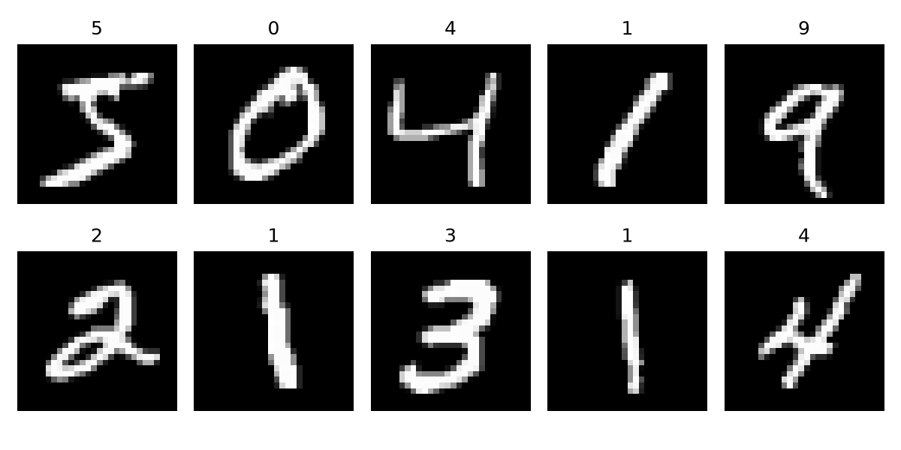
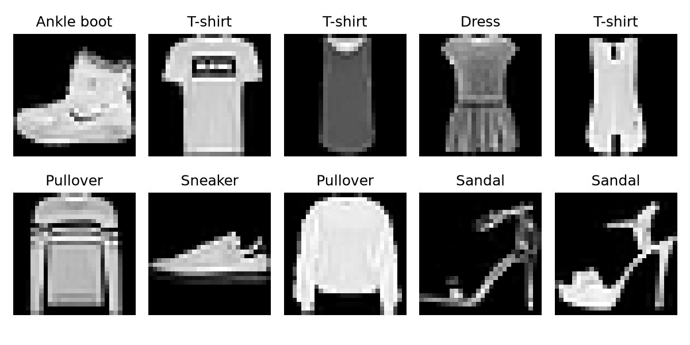

### Overview
### Setup
Clone `cnn-vs-mlp` and build two image recognizers from scratch. Take the CNN apart piece by piece to see what each component contributes.

<table width="100%"><tr><td valign="top" width="40%">

<sub>__Step 1__</sub>

Create a virtual environment and install the packages in the root folder.

</td>
<td valign="top" width="60%">

```bash
git clone https://github.com/jeenhan/cnn-vs-mlp.git
cd cnn-vs-mlp
```
```bash
python -m venv .venv
source .venv/bin/activate   # Windows: .venv\Scripts\activate
pip install -r requirements.txt
```

</td></tr></table>

<table width="100%"><tr><td valign="top" width="40%">

<sub>__Step 2__</sub>

Run the sample script then check the two grids saved in `figures/`. Each grid has 10 images, each image is a 28 by 28 grid of grey pixels paired to its label. The validation split uses seed __3__: 5,000 training images are held out from each training set.

</td>
<td valign="top" width="60%">

```bash
python -m scripts.look_samples
```
 

</td></tr></table>

### Reproducing Results

### Differences from LeNet-5
Architecture

Dataset size
- I held out 5,000 training images for validation and train on the remaining 55,000; the paper trains on all 60,000.
- The paper predates Fashion-MNIST.

Training budget

Evaluation

### Correctness Check
1. jax.nn.softmax

### Contributions
